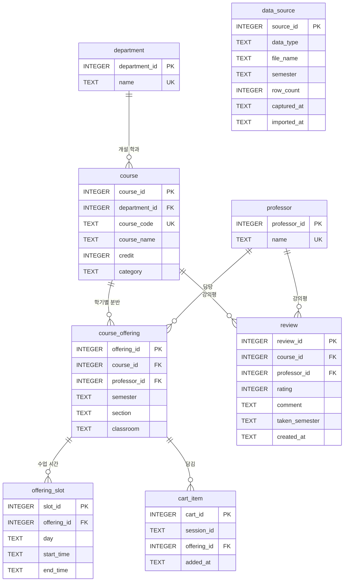

# 스키마 구조

SQLite DB 파일 `backend/data/processed/sugang.db`의 설계도입니다.
**Figma 화면 → 화면에 필요한 데이터 → 테이블** 순서로 정리했습니다.
`backend/scripts/init_db.py`는 이 문서의 표를 그대로 `CREATE TABLE`로 옮겨 적습니다 (로드맵 1주차).

- 디자인: [Figma — 비교 대시보드](https://www.figma.com/design/c7WveNcDRdkKDvRO3UzZkf/%EB%B9%84%EA%B5%90-%EB%8C%80%EC%8B%9C%EB%B3%B4%EB%93%9C--compare.html--1x?node-id=0-1)
- 테이블 8개: `department`, `course`, `professor`, `course_offering`, `offering_slot`, `review`, `cart_item`, `data_source`

---

## 1. 설계 기준

| 기준 | 내용 |
|---|---|
| 화면 기준 | Figma의 화면(내 시간표, 과목 찾기, 과목 상세 모달)에 보이는 정보만 저장한다. |
| 로그인 없음 | 학생 계정 테이블을 두지 않는다. 서버가 브라우저마다 만들어 주는 **세션 ID**로 "내 시간표"를 구분한다. |
| 개설정보는 CSV로만 | 수강편람 자동 수집은 하지 않는다. 팀이 준비한 CSV를 `import_csv.py`로 넣는다. 그래서 수강편람 원본 번호(`suup_no`) 대신 **(학기, 학수번호, 분반)**으로 개설 과목을 구분한다. |
| CSV는 이름으로 | CSV는 사람이 채우는 파일이라 DB 번호(`department_id` 등) 대신 학과명·학수번호·교수명을 쓴다. 이름을 번호로 바꾸는 일은 `import_csv.py`가 한다. |
| 이수체계도 제외 | Figma에 커리큘럼(이수체계도) 화면이 없고 기획상 보류 중이라 트랙·추천 학년·선수과목 정보는 이번 스키마에서 뺐다. 나중에 붙이는 방법은 §8 참고. |

---

## 2. 화면별로 필요한 데이터

| 화면 (Figma) | 화면에 보이는 정보 | 가져오는 곳 |
|---|---|---|
| 공통 헤더 | `2026-2학기 기준`, `최신 반영일 09.20` | 학기: `config.py`의 `CURRENT_SEMESTER` / 반영일: `data_source.captured_at` |
| 과목 찾기 – 왼쪽 필터 | 이수구분, 요일, 학점, 최소 평점 | `course.category`, `offering_slot.day`, `course.credit`, `review.rating` 평균 |
| 과목 찾기 – 검색 결과 표 | 과목명, 교수, 시간, 학점, 평점, `시간 겹침`, 담기/빼기 버튼, `검색결과 N개 과목` | `course`, `professor`, `offering_slot`, `review`, `cart_item` |
| 과목 찾기 – 오른쪽 미니 시간표 | 담은 과목 칸 색칠, 담은 과목 카드(이름·시간·교수), 겹침 경고 문구 | `cart_item` → `course_offering` → `offering_slot` |
| 과목 상세 모달 | 과목명, `CSE401 · 컴퓨터공학과`, 이수구분·학점·평균 평점 태그, 개설 정보(교수·학기·시간·강의실), 강의평 목록(별점·`2026-1 수강`·내용·개수), 평가 작성, 시간표에 넣기/빼기 | `course`, `department`, `course_offering`, `professor`, `offering_slot`, `review`, `cart_item` |
| 내 시간표 (홈) | 요일 × 30분 격자 위 과목 블록(과목명·강의실), `2026-2학기 · 3과목 9학점`, 담은 과목 목록, 총 학점, 빈 시간표 안내 | `cart_item`, `course_offering`, `offering_slot`, `course` |

> 시간표 블록 색깔은 화면에서 담은 순서대로 정하는 값이라 DB에 저장하지 않습니다.

---

## 3. 관계도 (ERD)



읽는 법: `||--o{`는 "왼쪽 1개에 오른쪽이 0개 이상". 예) 과목(`course`) 하나는 학기마다 여러 분반(`course_offering`)으로 열릴 수 있다.
`data_source`는 다른 테이블과 연결되지 않는 기록용 테이블이다.

---

## 4. 테이블 상세

공통 규칙
- `PK` 컬럼은 `INTEGER PRIMARY KEY`로 만든다. 값을 넣지 않으면 SQLite가 1, 2, 3… 번호를 자동으로 붙인다.
- 날짜·시각은 `TEXT`로 저장한다 (`'2026-09-20'`, `'2026-09-20 14:03:00'`). SQLite에는 날짜 전용 타입이 없다.
- `FK`(외래키)는 연결마다 `PRAGMA foreign_keys = ON`을 켜야 검사된다 (`app/db.py`의 `connect()`에서 처리).

### 4-1. `department` — 학과

과목이 속한 학과. 상세 모달의 `CSE401 · 컴퓨터공학과`에 쓰인다.
**채우는 곳:** `courses.csv`의 `department_name` (없는 학과명이면 `import_csv.py`가 새로 추가)

| 컬럼 | 타입 | 제약 | 설명 | 예시 |
|---|---|---|---|---|
| department_id | INTEGER | PK | 학과 번호 | 1 |
| name | TEXT | NOT NULL, UNIQUE | 학과명 | 컴퓨터공학과 |

### 4-2. `course` — 과목 (학기와 상관없는 정보)

학수번호·과목명·학점·이수구분처럼 **학기가 바뀌어도 그대로인 정보**.
**쓰는 화면:** 검색 결과 표(과목명·학점), 필터(이수구분·학점), 상세 모달(학수번호·태그)
**채우는 곳:** `courses.csv` (같은 학수번호가 있으면 새로 만들지 않고 내용만 고침)

| 컬럼 | 타입 | 제약 | 설명 | 예시 |
|---|---|---|---|---|
| course_id | INTEGER | PK | 과목 번호 | 1 |
| department_id | INTEGER | NOT NULL, FK → `department` | 개설 학과 | 1 |
| course_code | TEXT | NOT NULL, UNIQUE | 학수번호 | CSE401 |
| course_name | TEXT | NOT NULL | 과목명 | 기계학습 |
| credit | INTEGER | NOT NULL, CHECK (credit >= 1) | 학점 | 3 |
| category | TEXT | NOT NULL, CHECK (category IN ('전공필수', '전공선택', '교양')) | 이수구분. 과목 찾기 필터의 체크박스 3개와 같은 값 | 전공선택 |

> 실제 수강편람의 세부 구분(예: 전공핵심, 핵심교양)은 CSV를 만들 때 위 3개 중 하나로 바꿔 적는다. 바꾸는 기준은 팀이 정해 로드맵의 "팀 결정 기록"에 남긴다.

### 4-3. `professor` — 교수

**쓰는 화면:** 검색 결과 표의 교수, 상세 모달의 개설 정보, 검색어(교수명으로 검색)
**채우는 곳:** `offerings.csv`, `reviews.csv`의 `professor_name` (없는 이름이면 새로 추가)

| 컬럼 | 타입 | 제약 | 설명 | 예시 |
|---|---|---|---|---|
| professor_id | INTEGER | PK | 교수 번호 | 1 |
| name | TEXT | NOT NULL, UNIQUE | 교수명. 이름이 같으면 같은 사람으로 본다 | 김OO |

> 동명이인이 있으면 CSV에 `김철수(컴퓨터)`처럼 구분해서 적는다. 담당 교수가 정해지지 않은 분반은 `미정`으로 적는다.

### 4-4. `course_offering` — 이번 학기 개설 과목 (분반)

"**어느 학기에, 어느 과목을, 어느 교수가, 몇 분반으로, 어느 강의실에서**" 여는지.
검색 결과 표의 한 줄 = 이 테이블의 한 행. 화면과 API는 과목을 `offering_id`로 가리킨다.
**채우는 곳:** `offerings.csv`

| 컬럼 | 타입 | 제약 | 설명 | 예시 |
|---|---|---|---|---|
| offering_id | INTEGER | PK | 개설 번호 (API 주소에 쓰임: `/api/courses/1`) | 1 |
| course_id | INTEGER | NOT NULL, FK → `course` | 어떤 과목인지 | 1 |
| professor_id | INTEGER | NOT NULL, FK → `professor` | 담당 교수 | 1 |
| semester | TEXT | NOT NULL | `연도-학기` | 2026-2 |
| section | TEXT | NOT NULL | 분반. 같은 과목이 여러 반 열릴 때 구분 | 01 |
| classroom | TEXT | NOT NULL, DEFAULT '' | 강의실 (모르면 빈 문자열) | 공학관 401호 |

- 테이블 제약: `UNIQUE (semester, course_id, section)` — CSV를 다시 넣어도 같은 분반이 두 번 생기지 않는다.
- 인덱스: `idx_offering_semester ON course_offering (semester)` — 검색은 항상 이번 학기만 보므로.

> 수업 시간은 한 과목에 여러 개(화·목)라서 이 테이블이 아니라 `offering_slot`에 따로 저장한다.

### 4-5. `offering_slot` — 수업 시간 한 칸

개설 과목의 수업 시간을 **요일 하나당 한 행**으로 저장한다.
**쓰는 화면:** 검색 결과 표의 시간, 요일 필터, 시간표 블록, 시간 겹침 판단
**채우는 곳:** `offerings.csv`의 `day_time` 칸을 `import_csv.py`가 쪼개서 저장

| 컬럼 | 타입 | 제약 | 설명 | 예시 |
|---|---|---|---|---|
| slot_id | INTEGER | PK | 칸 번호 | 1 |
| offering_id | INTEGER | NOT NULL, FK → `course_offering` ON DELETE CASCADE | 어느 개설 과목의 시간인지 | 1 |
| day | TEXT | NOT NULL, CHECK (day IN ('월', '화', '수', '목', '금', '토', '일')) | 요일 | 화 |
| start_time | TEXT | NOT NULL | 시작 시각 `HH:MM` (항상 두 자리) | 11:00 |
| end_time | TEXT | NOT NULL | 끝 시각 `HH:MM` | 12:00 |

- 테이블 제약: `CHECK (start_time < end_time)`
- 인덱스: `idx_slot_offering ON offering_slot (offering_id)`

> - CSV에는 `화11:00-12:00,목11:00-12:00`처럼 한 칸에 적고, 저장할 때 2행으로 나뉜다. API는 다시 합친 `day_time` 문자열과 `slots` 목록을 둘 다 돌려준다.
> - 왜 나눠서 저장하나? 요일 필터(`EXISTS … WHERE day IN (…)`), 시간표 칸 그리기, 겹침 비교가 모두 "한 칸씩" 다루는 일이라 문자열을 매번 쪼개는 것보다 쉽다.
> - 시각을 `09:00`처럼 두 자리로 맞추면 문자열 비교(`'09:00' < '10:30'`)가 시간 비교와 똑같이 동작한다.
> - 시간 미정(온라인 등) 과목은 0행이다. 화면에는 `시간 미정`으로 보이고 겹침 검사에서 빠진다.
> - 화면 시간표는 월~금, 09:00~19:00만 그린다. 범위 밖 수업은 저장은 되지만 격자에는 보이지 않는다.

### 4-6. `review` — 강의평

학생이 남긴 **별점 + 서술형 후기**. 로그인이 없으므로 익명이다.
**쓰는 화면:** 상세 모달의 강의평 목록·개수, 검색 결과 표와 상세 태그의 평균 평점, 최소 평점 필터
**채우는 곳:** 앱의 "평가 작성" + 시연용 초기 데이터 `reviews.csv`

| 컬럼 | 타입 | 제약 | 설명 | 예시 |
|---|---|---|---|---|
| review_id | INTEGER | PK | 강의평 번호 | 1 |
| course_id | INTEGER | NOT NULL, FK → `course` | 어떤 과목의 후기인지 | 1 |
| professor_id | INTEGER | NOT NULL, FK → `professor` | 어느 교수 수업의 후기인지 | 1 |
| rating | INTEGER | NOT NULL, CHECK (rating BETWEEN 1 AND 5) | 별점 | 4 |
| comment | TEXT | NOT NULL | 서술형 후기 | 과제가 많지만 실습 위주라 남는 게 많아요. |
| taken_semester | TEXT | NOT NULL | 작성자가 들은 학기. 화면에 `2026-1 수강`으로 표시 | 2026-1 |
| created_at | TEXT | NOT NULL, DEFAULT CURRENT_TIMESTAMP | 작성 시각 (UTC). 목록을 최신순으로 정렬할 때 사용 | 2026-10-02 05:10:00 |

- 인덱스: `idx_review_course_prof ON review (course_id, professor_id)`

> **왜 `offering_id`가 아니라 과목 + 교수로 묶나?**
> Figma 상세 모달은 `2026-2 수강`, `2026-1 수강`, `2025-2 수강` 후기를 한 목록에 보여준다. 지난 학기 개설 정보는 DB에 없으므로 후기를 개설 과목에 묶을 수 없다.
> 대신 (과목, 교수)로 묶어서 "같은 과목이라도 교수가 다르면 평점도 다르다"는 점을 지킨다.
> **평균 평점** = 같은 `(course_id, professor_id)`를 가진 강의평의 `AVG(rating)`, 소수 첫째 자리까지. 강의평이 없으면 `NULL`(화면: `평가 없음`).

### 4-7. `cart_item` — 담은 과목 (내 시간표)

사용자가 **담기**를 누른 과목. 앱을 쓰는 동안 자동으로 쌓인다.
**쓰는 화면:** 내 시간표 전체, 과목 찾기의 담기/빼기 버튼·미니 시간표·`시간 겹침` 표시

| 컬럼 | 타입 | 제약 | 설명 | 예시 |
|---|---|---|---|---|
| cart_id | INTEGER | PK | 담기 번호 | 1 |
| session_id | TEXT | NOT NULL | 서버가 브라우저마다 만들어 쿠키에 넣어 두는 무작위 문자열 | 3f2a9c0e… |
| offering_id | INTEGER | NOT NULL, FK → `course_offering` ON DELETE CASCADE | 담은 개설 과목 | 1 |
| added_at | TEXT | NOT NULL, DEFAULT CURRENT_TIMESTAMP | 담은 시각. 목록 순서와 시간표 색 순서에 사용 | 2026-10-02 05:12:00 |

- 테이블 제약: `UNIQUE (session_id, offering_id)` — 같은 과목을 두 번 담을 수 없다.
- 인덱스: `idx_cart_session ON cart_item (session_id)`

> - 로그인이 없으므로 쿠키를 지우거나 다른 브라우저로 열면 빈 시간표가 된다.
> - "같은 과목의 다른 분반", "시간 겹침"은 DB 제약이 아니라 담기 API(`models.add_to_cart`)가 저장하기 전에 검사한다.

### 4-8. `data_source` — CSV 반영 기록

`import_csv.py`가 CSV 파일 하나를 DB에 넣을 때마다 한 줄씩 남긴다.
**쓰는 화면:** 헤더의 `최신 반영일 09.20` (= `data_type = 'offerings'`인 행 중 가장 최근 `captured_at`)

| 컬럼 | 타입 | 제약 | 설명 | 예시 |
|---|---|---|---|---|
| source_id | INTEGER | PK | 기록 번호 | 1 |
| data_type | TEXT | NOT NULL, CHECK (data_type IN ('courses', 'offerings', 'reviews')) | 어떤 CSV였는지 | offerings |
| file_name | TEXT | NOT NULL | 파일 이름 | offerings.csv |
| semester | TEXT | NULL 허용 | `offerings`일 때 그 학기, 나머지는 NULL | 2026-2 |
| row_count | INTEGER | NOT NULL | 반영한 행 수 | 42 |
| captured_at | TEXT | NOT NULL | 이 CSV가 **언제 기준 자료인지** (`YYYY-MM-DD`). `import_csv.py --captured-at`으로 넘김 | 2026-09-20 |
| imported_at | TEXT | NOT NULL, DEFAULT CURRENT_TIMESTAMP | 실제로 DB에 넣은 시각 | 2026-10-01 09:30:00 |

> `sugang.db`는 Git에 올리지 않아서 팀원마다 DB를 넣는 날짜가 다르다. 그래서 화면에는 넣은 시각(`imported_at`)이 아니라 자료 기준일(`captured_at`)을 보여준다.

---

## 5. 관계 요약

| 부모 | 자식 | 관계 | 부모 행을 지우면 |
|---|---|---|---|
| department | course | 1 : N | 지울 수 없음 (과목이 남아 있으면 FK 오류) |
| course | course_offering | 1 : N | 지울 수 없음 |
| professor | course_offering | 1 : N | 지울 수 없음 |
| course_offering | offering_slot | 1 : N | 수업 시간도 함께 삭제 (CASCADE) |
| course, professor | review | 1 : N | 지울 수 없음 |
| course_offering | cart_item | 1 : N | 담은 기록도 함께 삭제 (CASCADE) |

---

## 6. 조회 예시 — 검색 결과 한 줄 만들기

`app/models.py`의 `search_offerings()`가 쓰는 뼈대입니다. 필터 조건(`AND …`)과 `slots`·`in_cart`·`conflict` 값은 이 결과에 덧붙입니다.

```sql
SELECT o.offering_id, c.course_code, c.course_name, p.name AS professor,
       c.credit, c.category, o.classroom,
       ROUND(r.avg_rating, 1)      AS avg_rating,     -- 강의평 없으면 NULL
       COALESCE(r.review_count, 0) AS review_count
FROM course_offering o
JOIN course c    ON c.course_id = o.course_id
JOIN professor p ON p.professor_id = o.professor_id
LEFT JOIN (                                           -- LEFT: 강의평 0개 과목도 나와야 함
    SELECT course_id, professor_id,
           AVG(rating) AS avg_rating, COUNT(*) AS review_count
    FROM review
    GROUP BY course_id, professor_id
) r ON r.course_id = o.course_id AND r.professor_id = o.professor_id
WHERE o.semester = ?
ORDER BY c.course_name;
```

---

## 7. CSV 양식 (`backend/data/raw/`)

`import_csv.py`는 아래 3개 파일을 **이 순서대로** 읽습니다. 뒤 파일이 앞 파일의 학수번호를 참조하기 때문입니다.

공통 규칙
- 첫 줄은 아래 **영문 헤더 그대로** 적는다. 순서는 바뀌어도 되지만 이름이 다르면 오류가 난다.
- 저장 형식은 **CSV UTF-8**. 엑셀이라면 "다른 이름으로 저장 → CSV UTF-8(쉼표로 분리)"로 저장한다. 그냥 "CSV(쉼표로 분리)"로 저장하면 한글이 깨진다.
- 셀 안에 쉼표가 있으면(`day_time`) 큰따옴표로 감싼다. 엑셀은 저장할 때 알아서 감싸 주고, 메모장·VS Code로 직접 쓸 때는 손으로 감싼다.
- `01` 같은 분반을 엑셀이 `1`로 바꾸지 않도록 그 열은 셀 서식을 "텍스트"로 둔다.

### 7-1. `courses.csv` → `department`, `course`

| 컬럼 | 필수 | 설명 | 예 |
|---|---|---|---|
| department_name | ✔ | 학과명 | 컴퓨터공학과 |
| course_code | ✔ | 학수번호. 파일 안에서 겹치면 안 됨 | CSE401 |
| course_name | ✔ | 과목명 | 기계학습 |
| credit | ✔ | 학점 (1 이상 정수) | 3 |
| category | ✔ | `전공필수` / `전공선택` / `교양` 중 하나 | 전공선택 |

```csv
department_name,course_code,course_name,credit,category
컴퓨터공학과,CSE401,기계학습,3,전공선택
컴퓨터공학과,CSE402,데이터베이스,3,전공필수
```

### 7-2. `offerings.csv` → `professor`, `course_offering`, `offering_slot`

| 컬럼 | 필수 | 설명 | 예 |
|---|---|---|---|
| semester | ✔ | 학기 (`config.py`의 `CURRENT_SEMESTER`와 같게) | 2026-2 |
| course_code | ✔ | `courses.csv`에 있는 학수번호 | CSE401 |
| section | ✔ | 분반 | 01 |
| professor_name | ✔ | 교수명 (모르면 `미정`) | 김OO |
| day_time |  | `요일HH:MM-HH:MM`를 쉼표로 이어 적기. 비우면 시간 미정 | 화11:00-12:00,목11:00-12:00 |
| classroom |  | 강의실 | 공학관 401호 |

```csv
semester,course_code,section,professor_name,day_time,classroom
2026-2,CSE401,01,김OO,"화11:00-12:00,목11:00-12:00",공학관 401호
2026-2,CSE402,01,이OO,"월10:00-11:00,수10:00-11:00",공학관 502호
```

### 7-3. `reviews.csv` → `professor`, `review` (시연용 초기 강의평, 없어도 됨)

| 컬럼 | 필수 | 설명 | 예 |
|---|---|---|---|
| course_code | ✔ | `courses.csv`에 있는 학수번호 | CSE401 |
| professor_name | ✔ | 교수명 | 김OO |
| taken_semester | ✔ | 수강 학기 `YYYY-1` 또는 `YYYY-2` | 2026-1 |
| rating | ✔ | 1~5 정수 | 4 |
| comment | ✔ | 후기 (5~500자) | 선형대수 기초가 없으면 초반이 힘들 수 있어요. |

```csv
course_code,professor_name,taken_semester,rating,comment
CSE401,김OO,2026-1,4,선형대수 기초가 없으면 초반이 힘들 수 있어요. 질문하면 친절하게 답해 주십니다.
CSE402,이OO,2025-2,5,설계 과제가 실무에 가까워서 도움이 많이 됐어요.
```

> 강의평을 설문으로 모을 때는 이름·학번 같은 개인정보를 받지 않는다. 이 표에도 작성자 칸이 없다.

---

## 8. 이전 설계에서 바뀐 점

| 이전 (초기설정.md, 지시서 B) | 지금 | 이유 |
|---|---|---|
| `course.track`, `recommended_year`, `recommended_semester`, `course_prerequisite` 테이블 | 없음 | Figma에 이수체계도 화면이 없고 기획상 보류. 붙일 때는 `course`에 세 컬럼을 추가하고 `course_prerequisite (course_id, prerequisite_course_id)`를 새로 만든다. |
| `course_offering.suup_no` (수강편람 API 번호) | `section` + `UNIQUE (semester, course_id, section)` | 개설정보를 API가 아니라 CSV로 받기로 해서 원본 번호가 없음 |
| `course_offering.day_time` (문자열 한 칸) | `offering_slot` 테이블 | 요일 필터·시간표 그리기·겹침 계산을 쉽게 하기 위해 |
| `review.offering_id` | `review.course_id` + `professor_id` + `taken_semester` | 여러 학기 후기를 한 목록에 보여주는 Figma 화면을 위해 (§4-6) |
| `data_source.source_type ('api' / 'manual_csv')`, `source_url`, `department_id`, `parsed_at` | `data_type`, `file_name`, `semester`, `row_count`, `captured_at`, `imported_at` | API 수집이 빠져서 출처는 항상 CSV. 대신 어떤 파일을 언제 기준으로 넣었는지 기록 |
| `department.homepage_url`, `professor.department_id` | 없음 | 어느 화면에도 쓰이지 않음 |
| 로그인(학번) | 없음, `cart_item.session_id` 유지 | 기획상 로그인은 하지 않기로 함. Figma의 로그인 화면은 이번 범위에서 제외 |
